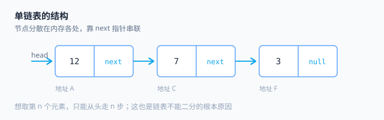

# 链表

链表是用指针把一组分散的节点串起来的线性结构。每个节点存一个值和指向下一个节点的引用。

## 是什么 {#what}



和数组最根本的区别在于**内存是否连续**。数组是一块连续内存，所以能用 `base + index * size` 直接算出第 n 个元素的地址；链表做不到，只能从头一个个走。

这个差异决定了一切：

| 操作 | 数组 | 链表 |
|---|---|---|
| 随机访问 `a[i]` | $O(1)$ | $O(n)$ |
| 头部插入 | $O(n)$ | $O(1)$ |
| 中间插入（已知位置） | $O(n)$ | $O(1)$ |
| 查找 | $O(n)$ | $O(n)$ |
| 内存占用 | 紧凑，可能有预留 | 每个节点多一个指针开销 |

注意「已知位置」这个前提。链表的插入本身是 $O(1)$，但找到那个位置通常要 $O(n)$，所以整体并不比数组快——除非你手上已经有那个节点的引用。

## 常见操作 {#operations}

**反转**。三指针迭代，核心是先把 `next` 存下来再改指向，否则链会断：

```js
function reverse(head) {
  let prev = null
  let cur = head
  while (cur) {
    const next = cur.next
    cur.next = prev
    prev = cur
    cur = next
  }
  return prev
}
```

**找中点**。快慢指针，快的走两步、慢的走一步，快的到底时慢的正好在中间。这个技巧同时能判断链表是否有环。

**删除节点**。需要一个 `prev` 指针，或者用「把下一个节点的值复制过来再删下一个」的技巧绕过前驱查找——后者在节点只给了引用时是唯一解，但删不了尾节点。

## 常见错误 {#pitfalls}

**丢了 `next` 就改指向**。反转时忘了先保存 `cur.next`，链表会从中间断裂，后面的节点全部丢失且无法恢复。

**头节点为空没处理**。几乎所有链表操作都要先判 `head === null`，否则第一行就抛错。

**环**。链表如果有环，任何「一直走到 null」的循环都会死循环。遍历前先想清楚数据是否可能有环。

**以为链表一定省内存**。每个节点多存一个指针（64 位系统上 8 字节），加上分配器的对齐开销，小数据量时链表反而比数组占更多内存。

## 相关

- [二分查找](../algo/1.binary-search.md)：链表不能用二分，因为它不支持 $O(1)$ 随机访问——这正是上面那张表的直接推论
