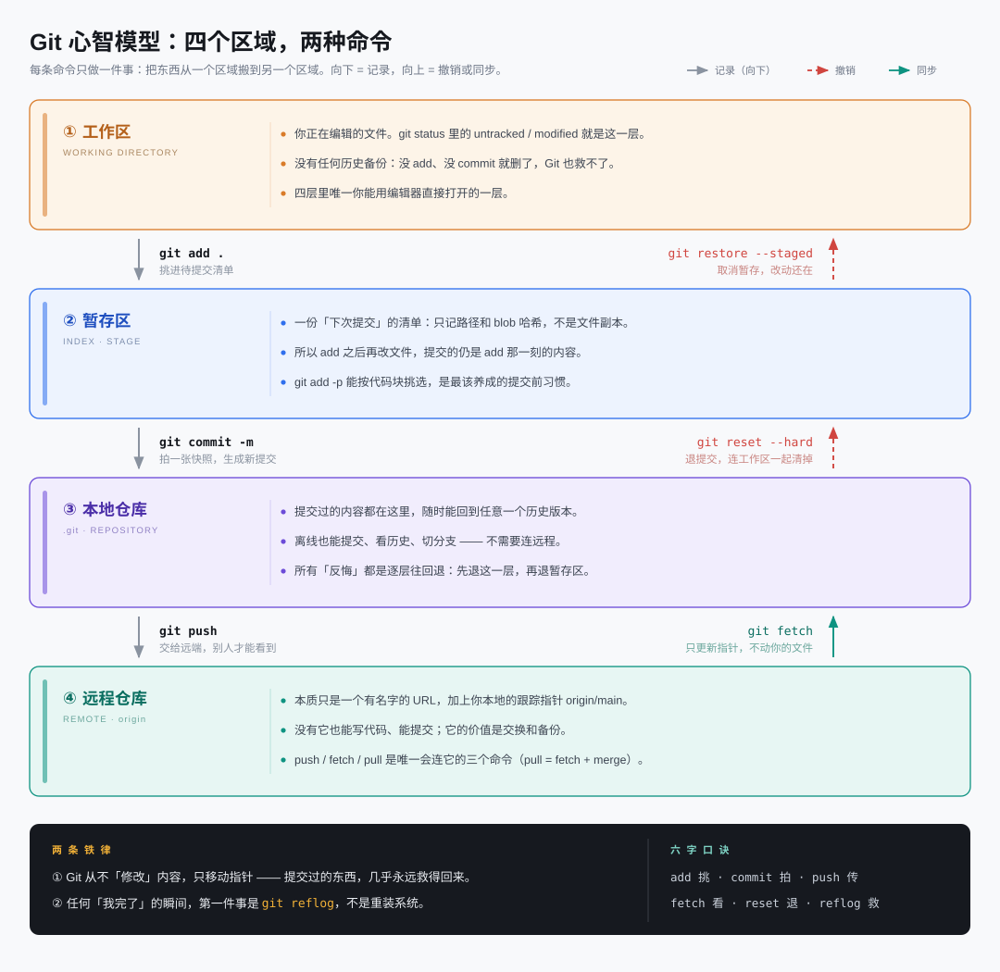

# Git 命令速查手册


---

## 0. 先配置，再开工

```bash
git config --global user.name  "你的名字"
git config --global user.email "you@example.com"
git config --global init.defaultBranch main

# Windows 建议加这条，避免换行符被改成 CRLF 导致整个文件 diff
git config --global core.autocrlf true
```

日常最少的三步：

```bash
git add -A && git commit -m "feat: xxx"
git push
```

---

## 1. 一张图记住所有命令



### 1.1 四个区域

| 区域 | 里面是什么 | 一句话 |
|---|---|---|
| **工作区** | 你正在编辑的文件 | 改了但没 `add`，Git 不管 |
| **暂存区** | 下次提交的清单 | `add` 过的内容 |
| **本地仓库** | 你的提交历史 | `commit` 过的内容 |
| **远程仓库** | 服务器上那份 | `push` 过的内容 |

### 1.2 一条规则：命令就是搬运

看图上的箭头方向，每条命令都能对上：

| 想做的事 | 命令 |
|---|---|
| 把改动放进清单 | `git add <file>` / `git add -p` |
| 提交 | `git commit -m "说明"` |
| 推到远程 | `git push` |
| 只把远程更新拉下来，不动我的文件 | `git fetch` |
| 拉下来并合进当前分支 | `git pull` |
| 取消暂存，改动保留 | `git restore --staged <file>` |
| 丢弃工作区的改动 | `git restore <file>` |
| 退提交 | `git reset --soft / --mixed / --hard` |

**朝下的箭头是「记录」，朝上的箭头是「擦除」。** 判断一条命令危不危险，看它朝哪边就够了。

---

## 2. 日常操作

### 2.1 开局

```bash
git init                    # 新项目
git clone <url>             # 已有项目
git clone --depth 1 <url>   # 只要最新代码，CI 里常用
```

### 2.2 每天的循环

| 命令 | 说明 |
|---|---|
| `git status -sb` | 最常用。改了哪些文件、在哪个分支，一眼看完 |
| `git add -p` | 逐块挑选要提交的改动，比 `add .` 干净 |
| `git commit -m "feat: xxx"` | 提交 |
| `git pull --rebase` | 开工前先拉一次，历史更干净 |
| `git push` | 提交完推上去 |

### 2.3 看状态、看差异、看历史

| 需求 | 命令 |
|---|---|
| 我改了哪些文件 | `git status -sb` |
| 我具体改了什么 | `git diff` |
| 我 `add` 了什么 | `git diff --staged` |
| 和历史比改了什么 | `git diff HEAD` |
| 提交历史（带分支图） | `git log --oneline --graph --decorate --all` |
| 最近 3 次提交的详细改动 | `git log -p -3` |
| 某次提交改了什么 | `git show <sha>` |
| 这个文件最近谁改的 | `git log --oneline -- <file>` |
| 这行代码是谁写的 | `git blame -L 10,20 <file>` |
| 哪次提交加/删了这段代码 | `git log -S"关键字"` |

### 2.4 分支

```bash
git branch                  # 本地分支
git branch -a               # 含远程分支
git branch -vv              # 含跟踪关系，看本地领先/落后几个提交
git switch -c feat          # 新建并切过去
git switch feat             # 切换
git switch -                # 回到上一个分支
git branch -d feat          # 删除已合并的分支
git branch -D feat          # 强删（还没合并也删）
git branch -m 旧名 新名      # 重命名

git merge feat              # 把 feat 合进当前分支
git merge --no-ff feat      # 强制生成一个合并提交，保留分支痕迹
```

### 2.5 远程

```bash
git remote -v                       # 看当前远程地址
git remote add origin <url>         # 添加（clone 下来的已经有了）
git remote set-url origin <new-url> # 换地址

git fetch origin                    # 只更新远程信息，不动我的文件
git fetch -p                        # 顺便清理远程已删的分支
git pull --rebase                   # 拉取并变基（推荐）
git push -u origin main             # 首次推送，建立跟踪
git push                            # 之后直接推
git push origin --delete feat       # 删远程分支
```

### 2.6 临时保存：stash

改到一半要切分支、要拉代码，先塞进「口袋」：

```bash
git stash push -m "写到一半的登录"   # 存起来
git stash -u                        # 连未跟踪的新文件一起存
git stash list                      # 看看口袋里有几份
git stash pop                       # 取回最新一份并删除记录
git stash apply stash@{1}           # 取回指定的那份，但保留记录
git stash drop                      # 丢掉最新一份
```

### 2.7 打标签

```bash
git tag -a v1.0 -m "release 1.0"    # 附注标签
git tag                             # 列出所有标签
git push origin v1.0                # 推单个标签
git push --tags                     # 推全部
```

---

## 3. 常见特殊情况

### 3.1 提交信息写错了 / 漏了文件

```bash
# 信息写错
git commit --amend -m "新的信息"

# 漏了文件，补进上一次提交（不弹编辑器）
git add 漏掉的文件
git commit --amend --no-edit
```

> 只对**还没 push** 的提交用 `--amend`。已经推上去的改了要强推，会影响别人。

### 3.2 提交了不该提交的文件

**刚提交、还没 push：**

```bash
git rm --cached .env            # 从版本库移除，本地文件保留
echo ".env" >> .gitignore
git commit --amend --no-edit
```

**`.gitignore` 加了却不生效？** 因为它只对未跟踪文件有效，已经提交过的必须先 `git rm --cached`。

**已经 push 出去了（尤其是密钥）：** 光删文件没用，历史里还在。需要重写历史（`git filter-repo`），并且**立刻去轮换密钥** —— 假设它已经泄露。

### 3.3 想撤销，该用哪个命令

**先问两句话：提交了吗？推送了吗？**

| 情况 | 想要的结果 | 命令 |
|---|---|---|
| 还没 `add` | 丢弃某个文件的改动 | `git restore <file>` |
| 已 `add`，没 `commit` | 取消暂存，改动保留 | `git restore --staged <file>` |
| 已 `commit`，没 `push` | 退提交，改动留在暂存区 | `git reset --soft HEAD~1` |
| 已 `commit`，没 `push` | 退提交，改动回到工作区 | `git reset HEAD~1` |
| 已 `commit`，没 `push` | 退提交，改动全部丢弃 | `git reset --hard HEAD~1` |
| 已经 `push` | 安全撤销 | `git revert <sha>` |

三个要点：

- `--soft` 最温柔，改动原封不动躺在暂存区，适合「重新组织提交」；
- `--mixed`（默认）退到工作区，`add` 的记录没了但代码还在；
- `--hard` 连代码一起清掉，**这是唯一会丢东西的一个**。

### 3.4 已经 push 了怎么撤

不要 `reset --hard` 再强推 —— 别人拉过这段历史，会全部冲突。用 `revert` 造一个反向提交：

```bash
git revert <sha>                 # 撤销某一次
git revert <sha1>..<sha2>        # 撤销一段（不含 sha1）
git revert -m 1 <merge-sha>      # 撤销一个合并提交，保留主线
```

### 3.5 合并冲突

冲突时文件里会出现这样的标记：

```text
<<<<<<< HEAD
  你这一侧的代码
=======
  对方那一侧的代码
>>>>>>> feature
```

处理步骤：

```bash
git status                  # 看哪些文件 both modified
# 打开文件，改成你想要的样子，把 <<<<<<< ======= >>>>>>> 全部删掉
git add <file>              # 标记为已解决
git commit                  # merge 冲突就这样结束
git rebase --continue       # 如果是 rebase，用这个继续
```

放弃这次合并：

```bash
git merge --abort
git rebase --abort
```

只想整份要一边：

```bash
git checkout --ours   <file>    # 要当前分支的
git checkout --theirs <file>    # 要对方分支的
```

> 注意：**rebase 时 ours / theirs 是反的** —— `ours` 指你正落在的上游基线，`theirs` 才是你正在搬的那串提交。拿不准就先 `git status` 看清楚再操作。

### 3.6 拉代码时本地有未提交改动

```bash
git stash
git pull --rebase
git stash pop
```

一条命令搞定：

```bash
git pull --rebase --autostash
```

### 3.7 只要别人的某一个提交

不想合整个分支，只要其中一次提交：

```bash
git cherry-pick <sha>
git cherry-pick -x <sha>      # 提交信息里记下来源，跨分支救火推荐
git cherry-pick --abort       # 冲突太多，放弃
```

### 3.8 忘了切分支，直接在 main 上改了

**还没 commit** —— 改动会跟着你走，直接建分支切过去：

```bash
git switch -c feature
```

**已经 commit 到 main 了** —— 把提交挪到新分支，main 退回和远程一致：

```bash
git branch feature           # 新分支指向当前提交
git reset --hard origin/main # main 退回远程状态
git switch feature
```

### 3.9 误删分支 / 误 reset 怎么找回

```bash
git reflog                  # 列出最近所有指针移动，找到那一行
# 9c1f4a7 HEAD@{1}: commit: feat: 刚才那次提交

git branch recovered 9c1f4a7      # 用那个提交建个分支
# 或者直接退回去
git reset --hard HEAD@{1}
```

只要提交过，基本都能捞回来。`reflog` 是本地记录，默认保留 90 天。

### 3.10 提交前把几个提交合成一个

```bash
git rebase -i HEAD~3        # 把最近 3 个提交列出来
```

编辑器里把要合并的那几行前面的 `pick` 改成 `squash`（或 `s`），保存退出，再整理一下合并后的提交信息。

不想用交互式，也可以整个分支压成一个：

```bash
git merge --squash feature
git commit -m "feat: 整个功能"
```

### 3.11 只回退某个文件到某个版本

```bash
git restore --source=<sha> <file>     # 把文件恢复到那次提交的样子
git checkout <sha> -- <file>          # 老写法，等价
git restore --staged <file>           # 只想取消暂存
```

恢复完记得 `git add` + `git commit`，否则只是改在工作区。

### 3.12 远程分支删了，本地还在

```bash
git fetch -p                 # 拉取时顺便清理
# 或
git remote prune origin
git branch -d 已经没用的本地分支
```

---

## 4. 报错对照表

| 报错 | 原因 | 怎么办 |
|---|---|---|
| `fatal: not a git repository` | 不在仓库目录里 | `cd` 到项目根目录 |
| `Please tell me who you are` | 没配用户名邮箱 | `git config --global user.name / user.email` |
| `Updates were rejected...` | 远程有你没有的提交 | 先 `git pull --rebase`，再 `push` |
| `Your local changes would be overwritten` | 工作区有未提交改动 | `git stash` → 操作 → `git stash pop` |
| `The current branch has no upstream branch` | 没建立跟踪关系 | `git push -u origin HEAD` |
| `You are in 'detached HEAD' state` | 头指针游离了 | 要保留改动：`git switch -c 新分支`；不要了：`git switch -` |
| `refusing to merge unrelated histories` | 两个互不相干的历史 | `git pull --allow-unrelated-histories` |
| `pathspec ... did not match any file(s)` | 路径写错，或文件已删 | 检查路径；删文件用 `git rm` |
| `Unable to create ... index.lock` | 上一个 Git 进程被强杀 | 确认没有 Git 在跑，再删掉 `.git/index.lock` |

---

## 5. 一页纸速记

```bash
# 每天都会用
git status -sb          git add -p            git commit -m "msg"
git switch -c feat      git switch -          git pull --rebase
git push                git log --oneline --graph --all

# 撤销（按危险度递增）
git restore <file>           # 丢弃工作区改动
git restore --staged <file>  # 取消暂存
git commit --amend           # 改最后一次提交
git reset --soft HEAD~1      # 退提交，改动保留
git reset --hard HEAD~1      # 退提交，改动全丢（危险）
git revert <sha>             # 反向提交，已推送时用它

# 临时处理
git stash                    # 存一下，待会儿再回来
git stash pop                # 取回来
git merge --abort            # 放弃这次合并
git rebase --abort           # 放弃这次变基

# 找东西 / 找回东西
git log -S"关键字"            # 谁引入或删了这段代码
git blame -L 10,20 <file>    # 这行谁写的
git reflog                   # 误操作后的后悔药
```

**记不住就记三句话：**

1. 往下是记录，往上是擦除。
2. 没提交用 `restore`，没推送用 `reset`，已推送用 `revert`。
3. 慌了先 `git reflog`。

---

## 参考

- 菜鸟教程《Git 教程》 — <https://www.runoob.com/git/git-tutorial.html>
- CSDN《Git 使用教程：最详细、最正宗手把手教学》 — <https://blog.csdn.net/qq_16027093/article/details/130503317>
- 官方命令手册 — <https://git-scm.com/docs>

> 配图源文件：`assets/git-map.svg`，同名 `.png` 为 2 倍分辨率位图，可直接放进 PPT 或文档。
