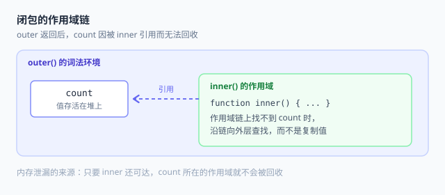

# 闭包

闭包是函数与其词法环境的组合——函数在定义时捕获了外层作用域的变量引用，即使外层函数已经返回，这些变量依然存活。

## 是什么 {#what}

判断依据只有一条：**函数内部引用了它定义位置之外的变量，并且这个函数被带到了定义位置之外执行**。



`inner` 被返回后，`outer` 的执行上下文已经出栈，但 `count` 没有被回收——因为 `inner` 的作用域链仍然指向它。这就是闭包的内存形态。

```js
function outer() {
  let count = 0
  return function inner() {
    count += 1
    return count
  }
}

const next = outer()
next() // 1
next() // 2
```

`count` 不是全局变量，也不是 `next` 的属性，它存在于 `inner` 的词法环境里。每次调用 `outer()` 都会创建一份全新的、互相隔离的 `count`。

## 什么时候用 {#when}

**保存私有状态**。上面的计数器就是最小例子：外部无法直接读写 `count`，只能通过 `next()` 间接修改。

**避免全局污染**。模块模式、IIFE 都是这个思路——把实现细节关在函数作用域里，只暴露必要的接口。

**回调里保持上下文**。事件处理、定时器需要访问创建时的变量，闭包是唯一自然的做法。

## 常见错误 {#pitfalls}

**循环里创建函数**。下面这段代码全部打印 `3`：

```js
for (var i = 0; i < 3; i++) {
  setTimeout(() => console.log(i), 0)
}
```

原因不是闭包失效，而是 `var` 只有函数作用域——三个回调捕获的是**同一个** `i`，循环结束时它是 `3`。把 `var` 换成 `let` 即可，因为 `let` 每轮迭代都创建新的绑定。

**以为闭包会自动释放**。被闭包引用的变量不会被垃圾回收。如果捕获的是 DOM 节点或大对象，就会造成内存泄漏。解决办法是在不再需要时把引用置空，或者干脆不捕获。

**在循环里给每个元素绑定事件时捕获索引**。和第一条同源，本质都是「捕获的是变量本身，不是当时的值」。

## 相关

- [类型与转换](./1.types.md)：同样是「规则确定但反直觉」，配合理解语言的作用域设计
