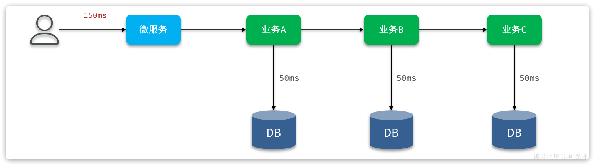
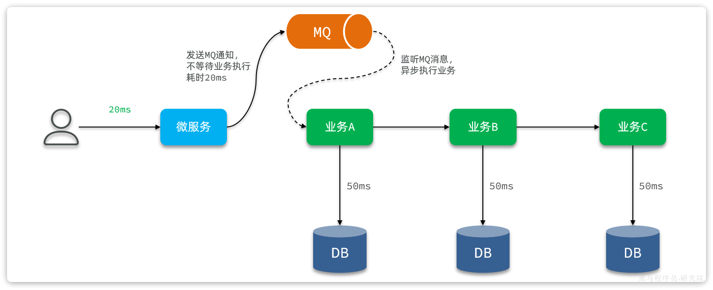

# rabbitmq

假如一个业务比较复杂，需要有多次数据库的写业务，如图所示：

由于各个业务之间是同步串行执行，因此整个业务的响应时间就是每一次数据库写业务的响应时间之和，并发能力肯定不会太好。

优化的思路很简单，我们之前讲解MQ的时候就说过，利用MQ可以把同步业务变成异步，从而提高效率。

- 当我们接收到用户请求后，可以先不处理业务，而是发送MQ消息并返回给用户结果。
- 而后通过消息监听器监听MQ消息，处理后续业务。

如图：

**优点**：

- 无需等待复杂业务处理，大大减少响应时间
- 利用MQ暂存消息，起到流量削峰整形作用
- 降低写数据库频率，减轻数据库并发压力

**缺点**：

- 依赖于MQ的可靠性
- 降低了些频率，但是没有减少数据库写次数

**应用场景**：

- 比较适合应用于业务复杂， 业务链较长，有多次数据库写操作的业务。

