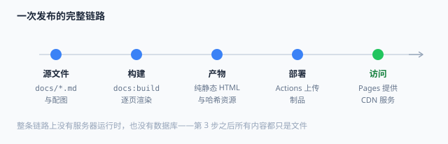

# 站点架构与构建

这个站点没有服务器、没有数据库、没有后端进程。你写的每个 Markdown 文件，在提交时被一次性编译成静态 HTML，之后由 GitHub 的 CDN 直接发给读者。

理解这句话，就理解了这个站点的全部运行逻辑。

## 整体链路 {#pipeline}



五个阶段各自负责一件事：

| 阶段 | 谁在做 | 产出 |
|---|---|---|
| 源文件 | 你 | `docs/` 下的 Markdown 和图片 |
| 构建 | VitePress（本地或 CI） | `docs/.vitepress/dist/` |
| 产物 | 构建结果 | 纯 HTML + 带哈希的静态资源 |
| 部署 | GitHub Actions | 上传到 Pages 的制品 |
| 访问 | GitHub Pages | CDN 直接返回文件 |

关键点：**前两个阶段发生在你的机器或 CI 上，后三个阶段完全由 GitHub 负责**。读者访问时，没有任何代码在执行，只是取文件。

## 目录结构与职责 {#structure}

```
NOTE/
├─ docs/                      ← 站点根目录，所有内容在这里
│  ├─ .vitepress/
│  │  ├─ config.mts           ← 唯一配置入口
│  │  └─ theme/
│  │     ├─ index.ts          ← 主题扩展入口（当前只引入默认主题）
│  │     └─ custom.css        ← 中文字体与排版微调
│  ├─ public/                 ← 原样拷贝，不参与构建处理
│  │  └─ logo.svg
│  ├─ drafts/                 ← 草稿，被 srcExclude 排除
│  ├─ quick/                  ← 分类：语言基础
│  │  ├─ index.md             ← 分类首页，同时提供侧边栏分组名
│  │  ├─ 1.types.md
│  │  ├─ 2.closure.md
│  │  └─ assets/              ← 该分类的配图
│  ├─ ds/  algo/  ops/        ← 其余分类，结构相同
│  ├─ site/                   ← 分类：本站说明（你正在看的）
│  └─ index.md                ← 首页
├─ .github/workflows/deploy.yml  ← 部署流水线
├─ .gitignore
├─ .gitattributes
├─ package.json
└─ README.md
```

三个位置的区别最值得记牢：

| 位置 | 会不会变成页面 | 构建时怎么处理 |
|---|---|---|
| `docs/**/*.md` | 会，路径即 URL | 渲染成 HTML |
| `docs/public/**` | 不会 | 原样复制到产物根目录 |
| 其他目录的图片 | 不会 | 被引用时才处理，加内容哈希 |

`docs/.vitepress/` 里的东西不会变成页面，它是配置和主题代码。

## 技术栈 {#stack}

| 组件 | 版本 | 作用 |
|---|---|---|
| VitePress | 1.6.4 | 静态站点生成器，负责渲染和打包 |
| vitepress-sidebar | 1.41.0 | 扫描目录，自动生成侧边栏 |
| markdown-it-mathjax3 | 4.3.2 | 数学公式渲染 |
| Node.js | 22（CI 环境） | 构建运行时 |

VitePress 本身基于 Vite 和 Vue：Vite 负责打包，Vue 负责页面运行时。所以 Markdown 里可以直接写 Vue 组件——**但本站刻意不用**，因为那会造成强绑定，详见[可移植性讨论](../index.md)。

## 一次构建做了什么 {#build}

`npm run docs:build` 实际执行 `vitepress build docs`，内部按顺序做七件事：

**1. 读取配置。** 加载 `docs/.vitepress/config.mts`，执行里面的代码。注意配置是一个可执行的 TS 模块，不是纯 JSON——所以能写 `process.env` 判断和函数。

**2. 扫描并生成侧边栏。** `withSidebar()` 会遍历 `docs/` 下所有 `.md`，按目录结构生成菜单树。这一步发生在渲染之前，所以侧边栏不是运行时算出来的，而是构建时就写死进 HTML 的。

**3. 逐页渲染。** 每个 `.md` 经过 Markdown-it 处理扩展语法（容器、代码高亮、公式），再编译成 Vue 单文件组件，最后服务端渲染（SSR）成 HTML 字符串。

**4. 处理静态资源。** 文章里用相对路径引用的图片，会被 Vite 接管：加内容哈希、小于 4KB 的内联成 base64、其余的输出到 `dist/assets/`。

**5. 生成搜索索引。** 把所有页面的标题和正文切词，输出成按页面分片的索引文件，放在 `dist/assets/chunks/`。读者搜索时按需加载。

**6. 校验链接。** `ignoreDeadLinks: false` 会让每一处站内链接和锚点都参与检查，指向不存在的目标就中断构建。

**7. 输出产物。** 全部写进 `docs/.vitepress/dist/`。

本地实测：9 个页面耗时约 7–9 秒，产物体积约 1.5 MB（其中大部分是字体文件）。

## 五条核心机制 {#mechanisms}

### 1. 文件即路由 {#routing}

文件路径直接映射成 URL，不需要注册路由表：

| 源文件 | 生成的页面 |
|---|---|
| `docs/index.md` | `/` |
| `docs/quick/index.md` | `/quick/` |
| `docs/quick/1.types.md` | `/quick/1.types` |
| `docs/site/assets/pipeline.svg` | 不生成页面，作为资源 |

`index.md` 是特例：它映射到所在目录的根路径，而不是 `/quick/index`。

**这是本站能做到「只写 md、不改配置」的根本原因。**

### 2. base 前缀 {#base}

站点部署在 `https://xx-pple.github.io/FT-knowledge/`，这个子路径就是 `base`。

```ts
const base = process.env.VITEPRESS_BASE || '/FT-knowledge/'
```

它影响两件事：所有静态资源的 URL 前缀，以及所有站内链接的解析。

配错的典型表现是**线上样式全丢、页面裸奔**——HTML 出来了，但 CSS 和 JS 都 404。

本地开发也带这个前缀（`http://localhost:5173/FT-knowledge/`），是刻意的：让本地和线上路径完全一致，避免只在部署后才暴露的问题。

### 3. cleanUrls {#cleanurls}

`cleanUrls: true` 让 URL 去掉 `.html` 后缀。产物仍然是 `1.types.html` 文件，但链接写成 `/quick/1.types`。

这条配置有一个反直觉的副作用：**开启后，Markdown 里手写 `.html` 链接会 404**。站内链接一律写 `.md` 或不带后缀，交给构建器转换。

### 4. 侧边栏自动生成 {#sidebar}

`config.mts` 里没有手写的 sidebar 数组，而是：

```ts
withSidebar(siteConfig, {
  documentRootPath: '/docs',
  useTitleFromFileHeading: true,
  useFolderTitleFromIndexFile: true,
  removePrefixAfterOrdering: true,
  excludeFilesByFrontmatterFieldName: 'draft',
  manualSortFileNameByPriority: ['quick', 'ds', 'algo', 'ops'],
})
```

三件事因此变成自动的：

- **菜单名**取页面的一级标题（`useTitleFromFileHeading`）
- **分组名**取该目录 `index.md` 的一级标题（`useFolderTitleFromIndexFile`）
- **组内顺序**由文件名数字前缀决定，前缀在显示时被去掉（`removePrefixAfterOrdering`）

分组之间的顺序由 `manualSortFileNameByPriority` 指定，未列出的按名称排在后面。

### 5. 构建期校验 {#validate}

三道检查会直接中断构建：

| 检查 | 触发条件 |
|---|---|
| 死链 | 站内链接指向不存在的文件 |
| 死锚点 | `#xxx` 找不到对应标题 |
| 缺失图片 | 相对路径引用的图片不存在 |

这是本站最重要的质量保证——问题在 `git push` 之前就暴露，而不是等读者点开发现 404。

## 部署链路 {#deploy}

`.github/workflows/deploy.yml` 定义了两个 job。

**触发**：推送到 `main`，或在 Actions 页面手动 `Run workflow`。

**build job（约 18 秒）**

| 步骤 | 作用 |
|---|---|
| `actions/checkout@v4` + `fetch-depth: 0` | 拉代码。必须完整历史，否则「最后更新于」取不到时间 |
| `actions/setup-node@v4` | Node 22，带 npm 缓存 |
| `npm ci` | 按 `package-lock.json` 精确安装 |
| `npm run docs:build` | 构建，产出 `dist/` |
| `actions/configure-pages@v5` | 确认 Pages 已启用 |
| `actions/upload-pages-artifact@v3` | 把 `dist/` 打成制品上传（约 819 KB） |

**deploy job（约 10 秒）**

| 步骤 | 作用 |
|---|---|
| `actions/deploy-pages@v4` | 把制品发布到 Pages 环境 |

两个 job 用 `needs: build` 串联，构建失败就不会部署。

**一个必须记住的前提**：仓库的 **Settings → Pages → Source** 必须是 **GitHub Actions**。

`configure-pages` 的 `enablement: true` 只对从未启用过 Pages 的仓库生效。如果仓库此前用「从分支部署」启用过，它不会改写来源，GitHub 会继续用 Jekyll 渲染根目录的 `README.md`。更麻烦的是，切换 Source 之后旧的分支构建结果不会自动被替换，必须重新跑一次 workflow。

## 本地与线上的差异 {#diff}

| 维度 | 本地 `docs:dev` | 本地 `docs:build` | 线上 |
|---|---|---|---|
| 渲染方式 | 按需编译 | 全量预渲染 | 静态文件 |
| 启动速度 | 秒级 | 7–9 秒 | 无 |
| 死链检查 | 提示但不断 | **中断构建** | 已固化 |
| 搜索索引 | 内存中 | 生成分片文件 | 加载分片 |
| 路径前缀 | 带 `/FT-knowledge/` | 同左 | 同左 |

差异最大的是死链：`dev` 模式下看到警告还能继续，`build` 模式直接失败。**所以 push 前跑一次 `docs:build` 是有意义的**，CI 跑的就是它。

## 为什么这么设计 {#tradeoff}

几个当时做过的取舍，留个记录：

**为什么不用 MkDocs**。oi-wiki 用的就是它，但 MkDocs 核心自 2024 年 8 月停止维护，Material 主题 2027 年 5 月终止关键维护。新项目照抄等于两年内必然迁移一次。

**为什么不用 Docusaurus**。它原生支持文档 + 博客双模式，但本站只要前者，为用不到的能力承担构建重量和 React 心智负担不划算。

**为什么不嵌 Vue 组件**。VitePress 允许在 Markdown 里写 Vue，能力很强，但一旦用了就绑死在 Vue 生态，以后想换框架要重写内容。速查库的价值在内容本身，不在技术栈。

**为什么草稿用目录而不是 frontmatter 标记**。VitePress 没有内置草稿机制，`draft: true` 只是往页面数据里塞了个没人读的字段，页面照样构建、照样能被 URL 访问、照样进搜索索引。只有 `srcExclude` 排除整个目录才是真的不发布。

## 故障排查 {#troubleshoot}

| 现象 | 大概率原因 | 怎么确认 |
|---|---|---|
| 线上样式全丢，白底黑字 | `base` 与仓库名不匹配 | 看 Network 面板里 CSS 请求路径 |
| 线上是 README 内容，标题带 `| 仓库名` | Pages Source 还是分支模式 | 看 `<html lang>` 是 `en-US` 还是 `zh-CN` |
| 所有子页面 404，首页正常 | 同上 | 直接访问 `/FT-knowledge/quick/` |
| 本地好、线上图片裂 | 文件名大小写不一致 | Windows 不敏感、Linux 敏感，全小写 |
| 构建报 dead link | 站内链接漏 `.md` 或路径写错 | 按报错提示改，别关 `ignoreDeadLinks` |
| 「最后更新于」全是今天 | checkout 缺 `fetch-depth: 0` | 检查 workflow 的 checkout 步骤 |
| push 后站点没变 | Actions 失败或没触发 | 看 Actions 页面的运行状态 |
| 搜索搜不到新文章 | 索引没重建 | 搜 `search` 相关分片是否更新 |

## 关键点回顾 {#summary}

如果只记五条：

1. **文件即路由**。放对目录、起对文件名，页面就存在了。
2. **构建期校验**是最有价值的一环，死链在 push 前暴露。
3. **`base` 必须和部署路径一致**，否则全站样式丢失。
4. **Pages Source 必须是 GitHub Actions**，且切换后要重跑一次。
5. **产物是纯文件**。没有运行时，所以访问快、成本低、能迁到任何静态托管。

## 相关

- [写作与发布教程](./2.writing-guide.md)：具体到每一步怎么操作
- [语言基础](../quick/index.md)、[数据结构](../ds/index.md)：内容示例
